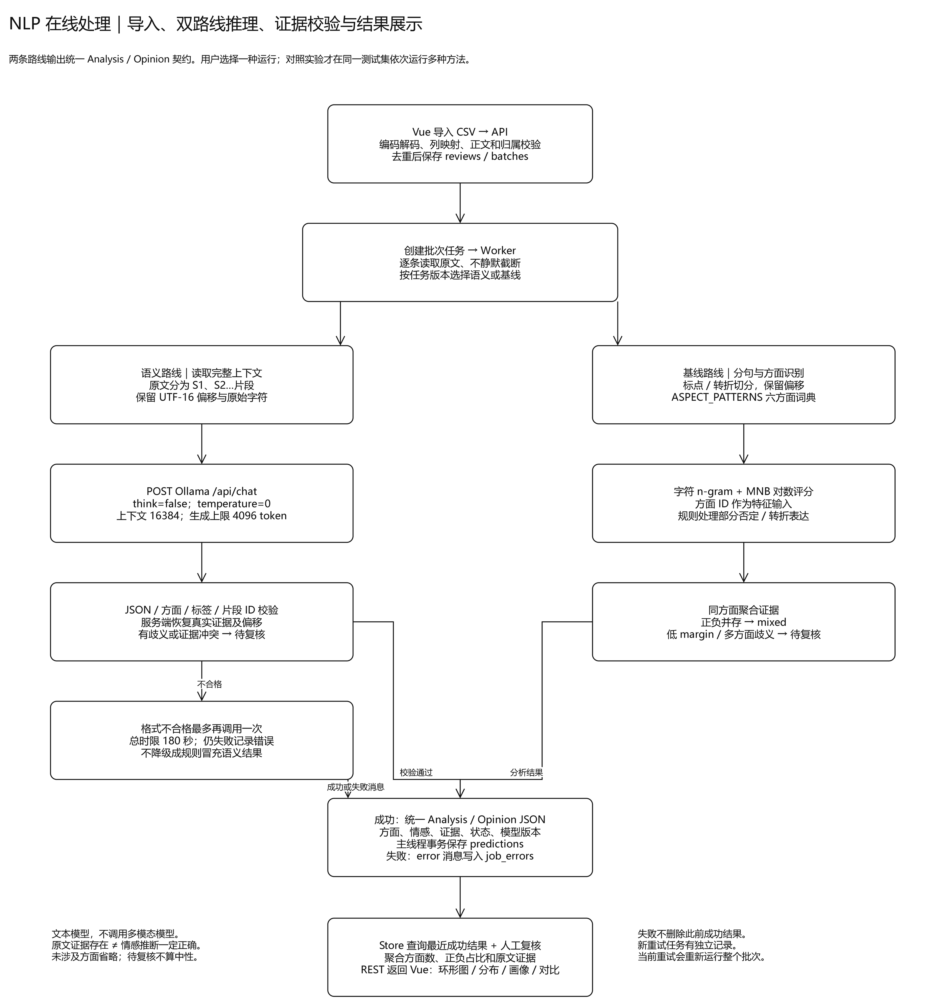
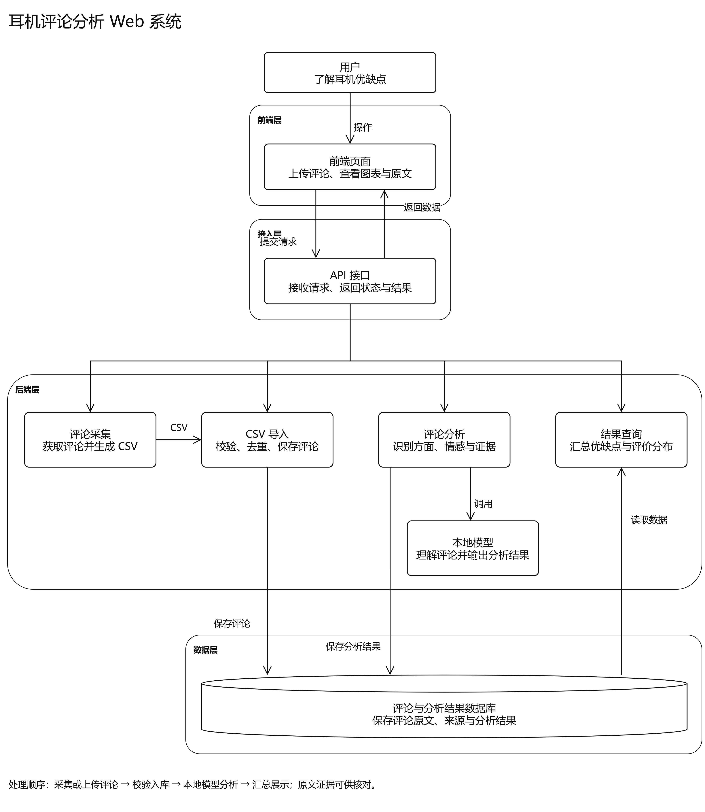
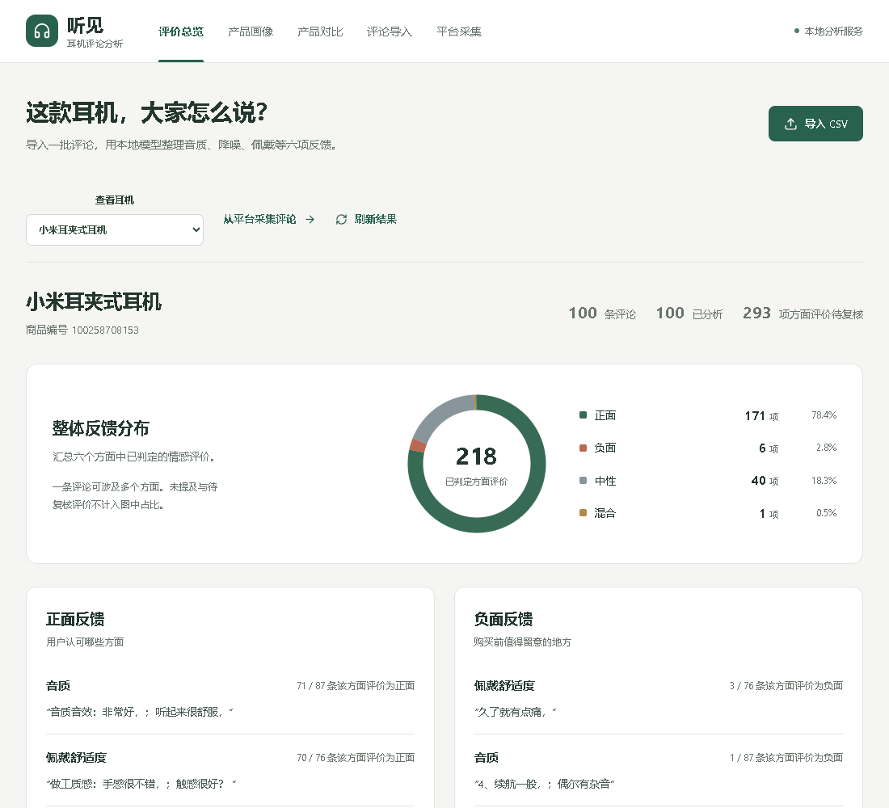
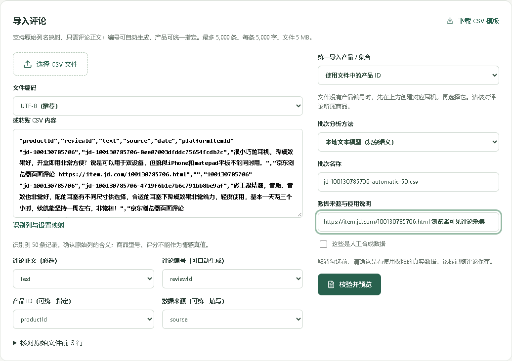

# 蓝牙耳机评论方面级情感分析系统实验技术报告

项目名称：听见耳机评论分析系统\
报告日期：2026年10月14日\
项目性质：三人课程大作业\
实现语言：TypeScript\
报告依据：当前工作区源码、实际数据库、模型实验记录、自动化测试与当前系统截图。

本报告围绕软件需求、详细设计、系统实现、测试评价和系统展示组织。正文描述已经实现的功能；待验收的指标、尚未开展的实验和历史版本结果另行注明。项目成员姓名、学号和实际贡献记录未提供，不虚构个人信息。文中实验证据经过源码和文件核对，提交前由项目组按课程任务书复核格式与署名。

## 摘要

蓝牙耳机评论往往同时涉及音质、降噪、佩戴、续航、通话与延迟，单一整句正负标签难以反映用户的实际意见。本项目开发了以方面级情感分析为核心的本地Web系统，支持上传具体商品的CSV评论，或使用Chrome辅助采集可见评论，经校验、去重与批次管理后调用本地文本模型，保存方面、情感和原文证据，并以情感环图、方面分布、产品对比和评论复核呈现结果。

系统采用Vue、NestJS、SQLite与Node Worker，业务代码和传统分类器训练均使用TypeScript。NLP设计包含两条路线：Qwen3:4b预训练文本模型通过Ollama执行结构化语义抽取；字符n-gram多项式朴素贝叶斯由项目自行训练，并结合领域规则作为基线。项目没有微调Qwen3，也没有使用多模态模型。当前构建与50项单元/集成测试、13项端到端测试通过；FreeBuds 6i实站自动采集达到50/50条。历史42条合成检查集上的模型对照用于工程分析，不能替代当前absa-v4在真实评论上的独立金标准评估。

关键词：自然语言处理；方面级情感分析；评论采集；朴素贝叶斯；本地文本模型；软件工程。

## 1 项目背景与工程方法

### 1.1 问题定义

用户关注的是某款耳机被认可和被抱怨的具体方面。例如“音质清晰，但戴久了耳朵疼”同时包含音质正面和佩戴负面。仅判断整条评论“好”或“坏”，会丢失购买决策所需的细节。系统将评论转化为“产品—方面—情感—原文证据”，对一批评论汇总，允许用户返回原文核对结论。

任务方向参考方面级情感分析的定义，但限定为耳机领域固定六方面，不复现SemEval公开任务完整数据集或榜单。方面包括sound音质、noise降噪、comfort佩戴舒适度、battery续航、call通话、latency游戏延迟。[SemEval任务原始论文](https://aclanthology.org/S14-2004/)

### 1.2 软件工程组织方式

开发采用需求确认、数据与模型试验、接口契约设计、增量实现、回归验证、界面优化和模块重构的过程。需求用唯一编号描述输入、处理、输出与验收条件；设计区分业务服务、数据访问和模型适配；测试同时检查正常路径、错误路径与既有行为。报告参考需求工程标准和产品质量模型的公开范围说明，不宣称通过完整标准认证。[需求工程标准](https://www.iso.org/standard/72089.html)、[产品质量模型](https://www.iso.org/standard/78176.html)

本项目按功能主线划分前端、后端和NLP任务，但实际个人分工需由项目组依据开发记录确认。共享契约、数据统计口径、模型版本字段和接口变更需要共同维护，不能只按文件数量评估工作量。

## 2 需求分析

### 2.1 用户与使用场景

普通浏览者查看一款具体耳机的评论总览、方面画像和产品对比。管理员维护产品、上传CSV、创建采集与分析任务、核对错误、修订情感并导出结果。开发者与课程验收者需要了解数据来源、训练方法、模块职责和可复现证据。

系统默认创建一个admin账号，同一账号可产生多个独立登录会话，未实现按人员隔离的数据空间和账号管理界面。登录凭证有效期为8小时，服务重启后重新登录；这不代表系统同时只允许一名用户在线。当前监听127.0.0.1，面向本机部署，未完成公网或局域网多人部署验收。

### 2.2 需求边界

本期需求是对有明确产品归属的中文文本评论开展六方面识别、四类情感归纳、证据定位、批次分析、可视化与复核。主要输入为评论CSV或指定商品链接；主要输出为结构化意见、批次状态、方面计数、正负反馈摘要和可下载CSV。

不纳入本期需求的内容包括电商交易、订单与支付、图片或音频情绪分析、开放式聊天、耳机声学测量、真假评论鉴定、全网商品搜索索引、自动绕过登录/验证和保证获取全部平台评论。物流、客服等领域外意见不强行归入耳机六方面；没有型号信息的通用评论不用于具体耳机推荐。

用户导入评论表示运行已有模型，不表示进行有监督训练。生成式模型给出的表达类型、强度和理由是模型判断；强度不是置信度。正负反馈摘要由已保存意见的统计和原文证据产生，不另调用一个选购推荐模型，不生成缺乏证据的总排名。

### 2.3 系统边界

系统内部包含浏览器页面、HTTP API、业务服务、CSV处理器、采集适配器、分析Worker、模型调用适配器、SQLite存储、统计聚合和复核导出。外部参与者包括用户、京东/天猫页面、Chrome程序、Ollama服务和Qwen权重文件。前端不直接访问SQLite，也不直接调用本地模型；请求统一经过API和服务器校验。

Chrome负责访问平台已允许用户查看的页面，平台决定评论是否可见、排序和加载方式。Ollama负责实际加载权重并执行计算，TypeScript后端负责请求编排和结果校验。Git仓库保存代码与已归档的数据文件；运行数据库、管理员密码、浏览器配置及大模型权重不是默认克隆内容。因此其他电脑需独立初始化账户、准备权重，并导入已有CSV或自行采集，不能把本机存在的数据视为跨电脑自动同步功能。

### 2.4 功能需求与验收条件

| 编号 | 功能 | 输入与处理 | 输出与验收条件 |
|---|---|---|---|
| FR01 | 产品与权限 | 产品编号、名称、说明；管理员登录后维护 | 非法或重复编号被拒绝；未登录写操作返回401 |
| FR02 | CSV导入 | 文件、编码、来源、字段映射与产品归属；校验及去重 | 预览有效、错误、重复数量；仅确认后事务写入 |
| FR03 | 平台采集 | 京东/天猫具体商品链接或编号、目标条数；可按链接创建产品 | 浏览器模式自动打开Chrome、评价区及滚动/翻页；满额完成，否则保存实际数量与原因 |
| FR04 | 批次任务 | 批次编号与分析模式；排队并串行运行Worker | 展示已尝试、成功/失败记录与版本；已成功结果不因后续失败被删除 |
| FR05 | NLP抽取 | 完整评论和所选模型 | 返回六方面内的意见、四类情感、证据、状态与版本；未提及不填标签 |
| FR06 | 汇总与画像 | 某产品的有效意见 | 正负摘要、情感环图、六方面分布；无样本不显示伪造比例 |
| FR07 | 产品对比 | 2至3个产品及关注场景 | 同方面分布和证据；保留样本量与待复核提示，不强制总排名 |
| FR08 | 复核与历史 | 方面、情感、真实原文片段、理由 | 追加修订，不覆盖原预测；纯模型视图不应用修订 |
| FR09 | 导出 | 产品和方面/情感等筛选条件 | CSV含来源、版本、证据与修订标记；公式型单元格转义 |

### 2.5 输入约束与非功能指标

| 类别 | 约束或指标 | 当前验收状态 |
|---|---|---|
| 文件边界 | CSV不超过5MB、5000行；支持UTF-8与GB18030 | 已实现并有输入校验测试 |
| 文本边界 | 语义模式每条最多5000字；基线最多1000字 | 超限明确拒绝或记录失败，不截断原文 |
| 采集边界 | 单次目标1至100条；浏览器最多1000次加载，20分钟会话上限 | 满额与部分采集区分；并非全量采集承诺 |
| 证据正确性 | 接收结果的证据必须为原文子串，UTF-16偏移合法 | 非法证据不入库；不等同于情感语义准确率 |
| 数据完整性 | 唯一约束、事务、去重；纯模型与人工修订隔离 | 功能回归与实际数据比对通过 |
| 可靠性 | 语义请求最多2次、总限时180秒；模型失败不静默降级 | 已实现；服务重启中断任务仍需用户重试 |
| 可维护性 | Controller/Service不直接SQL；NLP不依赖Web/API/DB；禁止扫描范围循环依赖 | 自动结构检查符合当前规则 |
| 软件功能 | 既有API、主要页面、导入/分析/复核/导出连续可用 | 50项核心测试、13项端到端测试通过 |
| HTTP性能目标 | 指定本机环境下分页/汇总P95不超过1秒 | 尚未完成磁盘数据库和HTTP全规模压力验收 |
| NLP质量目标 | 独立真实金标准上的方面—情感micro-F1至少0.80、macro-F1至少0.75 | 项目拟定目标，当前未验收，不属于标准强制值 |

性能及质量目标是本项目的建议验收门槛。现有证据不足以宣称所有电脑、所有平台或所有评论均达到上述目标。

### 2.6 关键用例与需求追踪

“导入并分析”用例的前置条件为已登录、产品归属明确；用户上传文件并核对字段，系统预览错误与重复行，确认后保存有效评论，再创建模型任务。成功后用户查看画像，失败条目显示理由；单条失败不回滚其他成功预测。

“采集并导入”用例由用户提交具体商品和数量触发。系统打开专用Chrome；需要登录或正常验证时等待用户完成，回到商品页后自动继续。系统逐段读取、去重，达到数量或确认无法继续后保存CSV；用户核对CSV并确认导入，采集本身不直接写入正式评论统计。

| 需求 | 主要设计模块 | 实现位置 | 主要验证 |
|---|---|---|---|
| FR01 | 权限与产品服务 | Auth、ProductService、AdminRepository | API鉴权与产品校验端到端场景 |
| FR02 | 导入服务与事务 | ImportService、importer、BatchRepository | 中文映射、编码、去重、重复提交场景 |
| FR03 | 采集服务与页面适配 | CollectionService、BrowserCollector、browser-review-navigation | 受控Chrome虚拟列表及任务19实站50条 |
| FR04至FR05 | 任务服务与模型接口 | AnalysisJobService、Worker、AnalysisEngine | 幂等、逐条失败保留、语义校验测试 |
| FR06至FR07 | 有效视图与聚合 | ReviewRepository、product-statistics | 统计口径、对比与实际数据库新旧比对 |
| FR08至FR09 | 修订及导出 | ProductService、ReviewRepository | 版本隔离、伪造证据拒绝、CSV转义 |

## 3 详细设计

### 3.1 NLP核心流程与统一契约

完整主线为：确认耳机领域任务 → 确定六方面及输出契约 → 准备评论和标注数据 → 选定两条模型路线 → 下载语义模型/训练统计分类器 → CSV上传或平台采集 → 校验、映射、去重并入库 → 批次排队 → Worker调用所选模型 → 原文证据校验 → 预测存储 → 同版本复核叠加 → 产品统计 → 可视化和证据查询。

Analysis包含原文、意见列表、警告、模型版本和耗时。每个Opinion包含aspect、sentiment、status和evidence；语义模型还给出expression、intensity与rationale。sentiment可为positive、negative、neutral、mixed；status为classified或review。证据包含text、start、end及局部情感，偏移采用UTF-16左闭右开区间。前端通过原文slice(start,end)定位，不对清洗文本重新计算索引。

### 3.2 数据获取与数据用途划分

系统区分业务评论、带标签训练语料和带参考答案检查集。业务评论用于了解某款耳机；训练语料用于统计参数学习；检查集用于计算模型成绩。三者不混合使用，未标注的买家评论不自动进入训练集。

| 数据类型 | 来源与规模 | 主要字段 | 用途与限制 |
|---|---|---|---|
| 初始展示数据 | data/demo.ts，3个虚构产品、36条合成评论 | 产品、原文、来源标记 | 初始化与功能验证，不代表买家意见 |
| MNB训练集 | 人工构造126条，每种情感42条；六方面各21条 | aspect、text、label | 训练三分类共享模型；没有真实数据泛化保证 |
| 基线教学检查集 | 另行构造24条 | 原文、方面—情感参考对 | 早期基线检查，不替代真实测试集 |
| 四方法对照集 | 固定42条合成文本，51个参考方面—情感对 | 原文、参考对、场景标记 | 同输入比较MNB、混合、规则、历史Qwen版本 |
| 实际平台评论 | 指定京东商品的可见文本，经Chrome生成CSV | productId、reviewId、text、source | 业务分析与采集验证；默认排序有限样本，非随机或全量 |

数据规模以当前文件核对为准，初始demo.ts为36条，运行数据库中另有后续导入，不能把数据库的38条或更多记录视为初始样例数。MNB训练文本由开发过程构造，不是从真实评论自动标注得到；没有开展双人独立标注一致性实验。

京东真实数据已归档到data/raw，例如FreeBuds 6i商品100130785706的50条自动采集CSV。文件中保存评论文本和商品来源，不保存浏览器Cookie或管理员凭据。没有平台接口授权时，匿名端点可能失败，浏览器辅助只读取当前会话允许查看的评论；不承诺其他商品均能获得足额数据。[真实采集实测](实验结果/FreeBuds6i自动采集修复实测.json)

如需寻找外部语料，可从[ChineseNlpCorpus网购评论目录](https://github.com/SophonPlus/ChineseNlpCorpus/tree/master/datasets/online_shopping_10_cats)、[中文Amazon评论](https://huggingface.co/datasets/SetFit/amazon_reviews_multi_zh)和[Amazon Reviews 2023项目](https://amazon-reviews-2023.github.io/)核对数据说明与使用条件。它们是候选来源，不是本次模型训练的数据；通用整句标签不等于六方面标签，缺少商品身份的数据不能直接归到华为或小米。CSV只是文件格式，JSONL或其他数据需转换并保留可靠商品归属。

### 3.3 CSV与采集设计

用户文件先在前端按所选编码解码，再由后端识别表头。中文或自定义列名通过映射转为text、reviewId、productId和source。正文必填；没有评论编号可生成编号，没有产品列可统一指定已有产品；来源必须注明，合成样例必须保留标记。

文件上限按5×1024×1024字节执行，界面的“5MB”为显示用语。预览阶段检查空文本、产品是否存在、长度、CSV格式和重复。去重同时使用“产品＋外部评论编号”和“产品＋文本指纹”；指纹基于NFKC规范化、删除空白、小写后SHA-256计算，仅用于比较，不替换保存的原文。预览标识有效期15分钟并绑定登录操作者，待提交预览最多30个。提交时检查标识，使用事务写入有效非重复评论、批次与校验概要；重复提交被拒绝。

Chrome采集使用专用持久化配置，经本机CDP连接，不复制日常浏览器配置。系统打开商品页、进入全部评价，优先读取完整评价弹窗。新版虚拟列表按视口高度约80%分段滚动，逐段读取并保存，避免跳到底部漏掉中间评论；仍在移动或高度增加时不算停滞，位置与数据持续20秒无进展才结束。传统分页使用下一页按钮。达到目标标为completed；提前停止标为partial并保留已有CSV。平台没有更多可见评论时不能补造数量。



图3-1 NLP在线分析流程。两种分析方法共享输入与Analysis输出契约，但一次业务任务只运行用户选定的方法；模型对照实验才在同一检查集上运行多种方法。图中只表示在线推理，模型准备与训练另见第3.4至3.6节，上传CSV不会自动训练。

### 3.4 模型选择与双路线准备

Qwen3路线用于尝试否定、反讽、隐含评价、比较、跨句指代和同方面矛盾；可训练MNB路线提供可解释、可快速复现的统计基线。选择大模型是能力探索，不预设它在本项目数据上一定胜出。Qwen官方资料提供模型背景，项目的实际行为以选定权重、提示版本与实验文件为准。[Qwen3官方说明](https://qwenlm.github.io/blog/qwen3/)

两条模型路线。路线A下载预训练权重并推理，没有项目内微调；路线B显式训练MNB参数。训练用CSV与业务导入CSV有不同字段与用途。


### 3.5 路线A 本地语义模型设计

实际选用qwen3:4b，历史部署记录为4.0B参数、GGUF Q4_K_M量化，模型文件2497293931字节，约2.50GB。权重在本机D:\NLP\大作业\模型权重，Ollama负责加载。历史实验记录使用RTX 5060 Laptop GPU，Node/TypeScript在CPU上编排；模型文件大小不等于显存占用，加载后的上下文缓存会额外消耗内存。其他电脑的权重位置通过OLLAMA_MODELS配置，不依赖该机器绝对路径。

完整原文同时传入模型。后端按标点产生S1、S2等连续片段，长片段按最多120个Unicode字符拆分，并保存原文UTF-16偏移；这是证据索引，不是先命中词典再删减上下文。提示词限定六方面、四类情感、表达类型、强度、状态与证据编号，并说明评论是分析数据而非系统指令。

Ollama请求采用/api/chat、think=false、temperature=0、num_ctx=16384、num_predict=4096。JSON Schema限定方面映射及字段枚举，模型只能选择已有spanId。结构化输出约束帮助规范格式，但不能保证情感判断正确。[Ollama结构化输出说明](https://docs.ollama.com/capabilities/structured-outputs)

服务器依据编号恢复证据正文和偏移，再检查方面、枚举、JSON、证据子串与情感一致性。uncertain或mixed缺少正负双侧证据时转review。输出截断或结构不合格时最多重新请求一次，总限时180秒；仍失败则写逐条错误，不转成规则结果冒充成功。当前语义版本为ollama-qwen3:4b-absa-v4，历史对照为absa-v2，二者成绩不可混用。

### 3.6 路线B 自训练MNB设计

训练使用126条aspect、text、label样例，每类正面、负面、中性各42条。对输入先转小写、去指定标点和空白，并拼接方面ID；随后提取字符1、2、3-gram频数。字符特征减少对中文分词器的依赖，但难以单独表示反讽与远距离指代。实际学习一个共享三分类模型，不是六个独立分类器。

训练累计每类文档数D_c、总特征频数T_c和各特征频数T_ct，词表V取训练样本出现过的特征。采用加一平滑，预测按下式比较对数得分，未知特征不进入累加。

> score(c,x) = log[(D_c + 1)/(D + 3)] + Σ_t n_t(x) · log[(T_ct + 1)/(T_c + |V|)]

式中D为全部训练文档数，n_t(x)为输入中特征t的频次。加一平滑避免未出现特征使概率为零。方法原理可参考多项式朴素贝叶斯说明，但本项目没有调用Python或scikit-learn训练接口，公式与代码由TypeScript实现。[多项式朴素贝叶斯文档](https://scikit-learn.org/stable/modules/naive_bayes.html#multinomial-naive-bayes)

输出参数包含词表、各类计数、数据类型、样本数与训练数据哈希版本。实测词表1172，参数文件51217字节，版本mnb-8a862b69；实验副本位于模型权重/classifiers，业务默认从data/model.json加载，MODEL_PATH可更改。历史train函数耗时约2.03ms，不含启动、读写文件。此训练属于统计计数，不存在神经网络的epoch、反向传播、GPU训练或loss曲线。

业务基线先分句、按方面词典识别，再产生MNB候选；明确领域规则优先校正候选，低margin（小于3）或意见归属歧义可待复核。同方面正负证据合并为mixed；混合是后处理，不是MNB第四个训练类别。pure MNB对照仍用方面词典，只关闭情感规则，其方面F1不代表分类器学会了方面识别。

目前训练集和检查集是独立保存的合成文件，未完成真实数据的训练/验证/测试分组划分。后续真实训练应先按产品、来源或时间分组，再在划分前去重，冻结测试集；由两人独立标注、第三人裁决，评估一致性后训练。真实用户复核现在不会自动回流训练。

### 3.7 任务调度与错误处理

批次任务按queued、running、completed或failed状态管理，单Worker串行处理评论，减少本地模型资源冲突。每条结果独立回写；processed表示已尝试数量，包含成功和失败，不等于成功数。前端显示批次名、来源、关联产品、模型版本、任务号、状态和历史记录，避免把旧失败当作最新任务。

同批次同版本已有非失败任务时返回原任务，失败后可新建重试任务。当前重试仍重新运行整批，尚未实现仅失败集合重试。服务启动时把遗留运行任务标为中断失败；同版本预测采用upsert，不保存该版本的每一次历史生成。任务历史、模型版本历史与逐次推理快照是不同概念。

### 3.8 数据库与有效结果视图

| 表 | 关键字段与关系 | 职责 |
|---|---|---|
| products | id主键、name、subtitle、source | 具体耳机与数据来源 |
| batches | id主键、name、source、created_at、summary | 导入批次与校验概要 |
| reviews | product_id外键、external_id、text、fingerprint、batch_id、synthetic | 原文与产品归属；两组唯一约束 |
| predictions | review_id＋version复合主键、result、updated_at | 版本化成功预测JSON |
| corrections | review_id、version、aspect、result、reason、actor、created_at | 追加人工修订与理由 |
| jobs | batch_id、status、total、processed、version、error | 批次分析生命周期 |
| job_errors | job_id＋review_id复合主键、message | 逐条失败追踪 |
| collections | product_id、platform、item_id、url、method、requested、total、status、csv | 采集记录与尚未正式导入的CSV |
| admins | username主键、password_hash | 本机管理员凭据 |

SQLite启用外键和WAL，导入使用BEGIN IMMEDIATE事务。每条评论选择updated_at、rowid排序的最近成功预测，再叠加该模型版本的修订；修订不跨版本应用，连续修订保留原模型意见。纯模型视图不叠加修订。批量有效视图只用两次SELECT，避免逐条查询复核记录；纯模型视图一次SELECT。

### 3.9 汇总与可视化口径

每条评论同一方面最多计一次。对方面a，N_a为positive、negative、neutral、mixed四类classified意见之和，正面占比为positive/N_a；N_a为0返回null，少于20条提示样本不足。review状态和未提及不进入分母，待复核单列，不将不确定性隐藏为中性。

首页环图将六方面已判定意见累加，其分母是方面评价数量，不是评论条数；一条评论涉及多个方面会贡献多项。正负摘要按各方面计数排序，并附原文证据，是可追溯统计摘要，不是生成式长文本总结。产品对比只比较相同方面并显示各自样本数；不同采样方式可能造成偏差，不能视为平台总体好评率或耳机性能测量。

## 4 系统实现

### 4.1 Web架构与技术选择

前端使用Vue 3与TypeScript组织表单、状态和图表；Vite构建页面。后端使用NestJS处理JSON接口与鉴权，Node Worker隔离批量推理编排；SQLite适合课程规模的本地持久化；Chrome/CDP适配平台页面；Ollama提供本地权重运行。前端页面在浏览器执行，通过JSON请求后端；当前后端同时提供构建后的静态资源，不负责服务器端页面渲染。

采用TypeScript首先满足课程约束，并便于前后端共享方面枚举、状态和结果类型。MNB计数训练可直接在Node运行，Qwen计算交给Ollama，因此无需为当前任务额外引入Python运行服务。Python在神经网络训练与微调生态中更丰富，但本项目没有实施该类训练；语言选择服务于当前边界，不宣称TypeScript在所有NLP任务中优于Python。

### 4.2 模块实现与低耦合设计

前端useSingleAnalysis、useProductReviews、useProductComparison、useDataWorkspace、useAuth、useProductManagement按场景管理状态；模块协作使用ref参数或回调，不相互导入展示组件。App.vue负责路由组合、公共反馈、模型状态及轮询，页面模板仍可继续按路由拆分。

ApiController仅处理路由、输入与鉴权、响应头和服务转发。CollectionService管理采集状态，ImportService管理预览与提交，AnalysisJobService管理Worker与队列，ProductService管理查询、修订和导出，ModelService管理模型信息与单条限流。application-services在启动时组装依赖；六类Repository集中SQL，统计为纯函数；AnalysisEngine统一语义和基线入口，NLP不反向依赖前端或数据库。

重构前Controller含39处直接SQL调用，重构后为0，30个API端点保留；App.vue的ref声明从46处降到5处，其余移动到对应业务模块。扫描范围内运行时循环依赖和已定义分层违规为0；这不是LCOM或全系统内聚度百分比。模块拆分增加文件数与显式依赖边，不能仅凭数量判断架构质量。[结构检查原始结果](架构图/架构检查指标.json)



图4-1 Web系统设计图。方框表示应用组件，圆柱表示存储，按前端、接入、后端和数据分层。采集产生CSV，导入写原始评论，分析写预测，查询读有效结果并返回前端。图中组件属于同一后端应用的功能模块，不是独立部署的微服务。

### 4.3 接口与端到端实现

| 接口 | 作用 | 权限与结果 |
|---|---|---|
| POST /api/auth/login | 登录并获得Bearer会话 | 本机admin；密码scrypt校验 |
| POST /api/imports/columns、preview、commit | 识别列、预览、提交 | 管理员；预览归属与事务保证 |
| POST /api/collections | 创建公开或浏览器任务 | 管理员；一次请求自动进入采集 |
| GET /api/collections/:id/csv、data | 下载或载入采集CSV | 管理员；无数据不提供假CSV |
| POST /api/jobs | 对导入批次创建分析任务 | 管理员；返回任务与实际模型版本 |
| GET /api/jobs、/api/jobs/:id/errors | 进度与逐条失败 | 管理员；processed为已尝试 |
| GET /api/products/:id/stats、summary | 六方面统计和证据摘要 | 浏览者可读 |
| GET /api/reviews、/api/compare | 筛选评论及产品对比 | 浏览者可读 |
| PATCH /api/reviews/:id/correction | 追加人工复核 | 管理员；真实原文证据必填 |
| GET /api/export | 导出有效或纯模型视图 | 管理员；CSV公式转义 |

导入后前端先显示保存数量，再创建任务并轮询状态。Worker将Analysis或错误通过线程消息返回，主线程用仓储事务保存预测、错误和尝试数。查询加载最近成功预测与同版本修订，纯函数计算方面分布，再以JSON返回Vue。单条辅助分析不写正式产品统计。

### 4.4 从零实现与运行顺序

第一步确认用户目标、六方面边界、输入与验收条件。第二步建立TypeScript工程和packages/contracts，确定CSV、Analysis、Opinion与任务契约。第三步编写合成训练与检查语料，实现MNB、方面规则和评分口径，保存参数与版本。第四步下载Qwen权重并验证Ollama服务，设计提示、结构化输出和原文恢复。第五步建立SQLite表、唯一约束和事务，再实现导入、Worker、查询与复核。第六步完成CSV页面、环图、分布、对比和导出。第七步接入专用Chrome采集，验证分页、登录等待与虚拟滚动。第八步执行回归、记录真实采集与模型对照，重构服务/仓储/状态边界，并整理报告。

本项目运行代码与训练程序为TypeScript。首次安装由npm锁文件重建依赖；其他电脑管理员账户与运行数据库独立生成，模型权重需另外下载。以下命令用于复现环境和功能检查，不代表重新执行历史模型对照即可获得同样分数。

```powershell
npm run setup
npm run model:start
npm run model:pull
npm start
```

基线训练可执行npm run train；外部训练CSV需指定--data、--kind与--output，且每个三分类标签至少有三条样例。训练集、输出参数和MODEL_PATH需明确，不能覆盖检查集标签后再评价。程序中的requirements.txt是Node环境说明，不是pip清单。

### 4.5 前端实现与整批反馈界面



图4-2 用户选择小米耳夹式耳机后查看实际批量评论总览，入口包括导入CSV、平台采集和刷新结果。首页以整批评论为对象，单条辅助分析不作为主要业务入口。

环图与数量图例展示已判定方面评价分布，未提及与待复核不计入占比；待复核总数在总览另列。正负反馈与原文证据在页面其他部分配合使用；图中评价数量不等于独立买家人数。


## 5 系统测试与模型评价

### 5.1 测试策略与环境

测试分为算法/导入单元测试、仓储与任务集成测试、受控Chrome测试、HTTP/页面端到端测试、真实平台采集验证和模型对照。浏览器受控HTML和模拟模型协议用于验证程序行为，真实平台与真实模型运行则作为独立证据；二者不混写。

本机历史实验环境为Windows、Node v24.14.0、Intel Core Ultra 9 275HX，系统记录33752997888字节内存，GPU为RTX 5060 Laptop，显存8151MiB。Ollama历史运行时为0.40.3，Qwen实验上下文16384，记录显示GPU运行。设备高于普通课程电脑，时延不可直接外推。[模型对照资源与记录](实验结果/模型对照结果.json)

### 5.2 软件验证结果

2026年10月14日自动采集修复后，npm run build成功；完整npm test为50项、12个文件通过；端到端为13个场景通过，使用3002端口和隔离测试数据库。覆盖文件映射、去重、鉴权、任务幂等、失败保留、版本修订、导出、移动布局、浏览器滚动/分页及正常登录恢复。没有以“测试全部通过”替代代码覆盖率统计，也未开展长时间生产稳定性或公网并发安全验收。

重构阶段以实际SQLite只读连接对products、batches、reviews与stats进行26组新旧实现比对，结果全部一致；当时快照为238条评论、232条预测，属于该时点证据，不是当前实时数据总数。另有1000条评论回归检查：有效视图两次SELECT，pure视图一次，纯聚合不再查询数据库。[数据一致性记录](架构图/重构数据一致性验证.json)

### 5.3 NLP指标与历史对照结果

方面识别将每条评论的方面集合与参考集合比较；方面—情感对只统计classified意见。P=TP/(TP+FP)，R=TP/(TP+FN)，F1=2TP/(2TP+FP+FN)。micro对全体样例累加；macro对有参考支持的情感类别F1取平均。失败样例的参考标签仍进入FN，不删除失败样例抬高成绩；待复核未覆盖的参考意见在端到端评分中计漏判。

辅助指标包括完全匹配率、请求失败率、待复核意见率、证据子串合法率，以及成功调用函数耗时P50/P95。证据合法率只能说明有真实片段，不能证明该片段支持模型的情感推断；无证据时指标为null而非100%。时延不包含Web统计和入库，且失败调用不进入成功时延分位数。

下表描述历史absa-v2合成检查实验，不能作为当前absa-v4真实评论准确率。


| 方法 | 方面F1 | 方面—情感micro-F1 | 情感macro-F1 | 请求失败 | 成功函数P95 |
|---|---|---|---|---|---|
| pure MNB | 98.04% | 78.43% | 77.01% | 0/42 | 0.46ms |
| MNB＋规则 | 98.04% | 79.55% | 75.39% | 0/42 | 0.36ms |
| 仅领域规则 | 98.04% | 76.74% | 73.09% | 0/42 | 0.37ms |
| Qwen3 absa-v2 | 85.39% | 74.16% | 55.46% | 3/42 | 2516ms |

同一42条合成检查集包含51个参考方面—情感对。Qwen该轮总体成绩低于基线，中性参考召回存在明显问题，不能预设大模型全面优胜。hybrid待复核率为27.45%，规则为31.37%；语义成功输出待复核为0也不等于可靠。训练与检查集来自同一开发过程，提示修订也使用过该检查集，因此不是独立真实测试集。[原始逐条结果及指标](实验结果/模型对照结果.json)

当前absa-v4完成真实评论业务分析和结构化校验，但尚无独立人工标注的真实金标准F1。已有一次本地HTTP冒烟对四个方面输出原文证据且偏移合法，耗时11471ms含冷加载；它证明接口可运行，不是质量评测。未来需冻结真实测试集，按反讽、指代、混合、长度和产品分层报告结果，再判断是否达到第2章拟定质量门槛。[本地模型冒烟证据](架构图/重构本地模型冒烟验证.json)

### 5.4 查询性能与自动采集验证

| 合成评论规模 | importRows耗时 | 统计P50 | 统计P95 |
|---|---|---|---|
| 100条 | 4.68ms | 1.09ms | 1.38ms |
| 1000条 | 18.27ms | 11.35ms | 12.25ms |
| 5000条 | 89.65ms | 78.97ms | 84.55ms |

性能使用内存SQLite、合成短文本，统计包含完整仓储读取与六方面聚合，预热后采样20次。importRows不包含文件解析，均不包含HTTP、磁盘数据库和模型生成。上述结果说明当前批量查询的局部开销，不能等同于5000条语义分析或HTTP压力目标已验收。[性能原始数据](架构图/查询性能验证.json)

真实Chrome采集修复验证：FreeBuds 6i商品100130785706，原任务18采到4/50条；按虚拟列表分段滚动修复后，任务19通过一次POST /collections达到50/50、completed、error=null，CSV经数据库回写和下载核对，全程没有人工翻页。该结果有真实平台依据，不仅是测试夹具，但只对应当次商品与已有登录状态。[50条采集实测](实验结果/FreeBuds6i自动采集修复实测.json)

### 5.5 缺陷处理与已知限制

已处理的主要问题包括把商品预览当作完整评价、虚拟列表一次跳底漏采、短暂无新增导致提前结束、结构化输出证据不合法、Controller直接SQL、评论查询N+1和批次展示不明确。针对各问题分别加入受控浏览器、协议校验、仓储及页面回归证据。

仍未完成的事项包括真实金标准建立、神经网络微调、全量平台采集、失败集合精确重试、同版本逐次预测快照、多用户数据隔离，以及跨电脑自动同步数据库。权重与运行数据库不在默认Git克隆内容，不能据此假设另一台电脑已具备本机数据和模型环境。系统边界和验收范围随需求扩展应重新评审。

## 6 系统展示

本章截图来自当前127.0.0.1:3001服务和真实业务数据库，不使用模拟API。截图时只浏览、切换产品、登录及解析CSV表头，没有新建产品、提交导入或重新分析。页面中的数量是截图时点状态；真实评论分析结果仍可能需要复核，不能直接视为产品测评结论。

### 6.1 核心页面操作

评价总览见系统实现章节图4-2，其中包括整批情感环图与正负反馈。本章用操作说明介绍其他页面，仅再插入CSV导入和采集完成两张关键截图。

### 6.2 产品画像与同维度对比

六方面分布、正面占比和样本提示。用户可按方面、情感和原文关键词筛选，切换纯模型视图，管理员可复核。未提及和待复核不混入正面占比分母。


华为与小米具体商品的同方面比较。界面保留各产品样本数、待复核和原文依据，用户可以按通勤、游戏或长时间佩戴聚焦维度。该比较是当前采样评论的统计，不是不同商品总体满意度的无偏比较。


### 6.3 CSV导入与分析任务



图6-1 真实FreeBuds 6i的50条CSV载入工作台，识别字段并记录商品来源。截图仅解析表头，没有点击提交；确认导入后才写评论并创建分析任务。

分析任务按批次分卡展示，注明数据来源、关联耳机、数量和模型版本。默认显示最新任务，历史记录可展开；进度是已尝试，失败可查看逐条原因。


### 6.4 平台采集入口与完成记录

输入商品页或编号和目标数量，点击打开Chrome辅助采集。系统自行打开评价区并加载，用户无需逐页翻动；正常登录/验证是外部平台条件。


图6-2 FreeBuds 6i的50/50完成记录，支持下载CSV与预览导入。旧部分采集记录如实保留，不能将历史失败直接改写为成功。该图与实测JSON共同支持自动采集链路已经运行。

## 7 实验结论与改进方向

项目已形成采集或上传具体耳机评论、校验导入、模型分析、结构化存储、统计可视化与人工复核的闭环。方面级设计保留同条评论内的多元意见和原文依据，比仅给整句正负标签更符合本项目的用户目标。职责分离和自动检查降低了业务编排、模型与存储之间的直接耦合，功能回归和真实数据比对支持当前重构保持既有行为。

实验尚不能证明当前语义模型在真实独立评论上优于基线。历史合成对照显示两条路线各有优势与缺陷，当前优先改进应是构建真实金标准、校准待复核策略和版本溯源，再考虑扩大训练语料或开展参数高效微调。平台采集需要随DOM变化维护；数据与权重在其他电脑的可移植交付应另行完善，不能只靠代码克隆完成运行环境与业务数据同步。

## 附录A 可复现检查与材料索引

```powershell
npm run typecheck
npm run build
npm test
npm run test:e2e
npm run check:architecture
npm run benchmark:queries
```

模型训练与评价命令使用本地数据执行；重新运行experiment会采用当前提示版本并覆盖现有结果，复现历史absa-v2需要对应源码和配置，不能直接用当前absa-v4重跑后沿用原文件标签。

```powershell
npm run train
npm run train -- --data 已标注训练集.csv --kind 授权真实训练集 --output data/custom-model.json
npm run evaluate
npm run experiment
```

本报告仅插入两张draw.io图：图3-1的可编辑源为[NLP图](架构图/NLP核心功能与双模型流程.drawio)的在线流程页，图4-1的源为[Web图](架构图/Web系统设计与使用流程.drawio)。模型训练与指标通过正文和表格说明，不再重复插图。系统截图在docs/系统截图，可通过截图说明核对时间与来源。真实CSV、参考标签与训练数据分别位于data/raw、docs/实验结果/固定对照测试集.json和docs/实验结果/MNB训练数据.csv。

## 附录B 证据与参考资料

内部证据：当前packages/nlp/model.ts、index.ts、semantic.ts与engines.ts核对训练和推理；apps/api/src及repositories/services核对存储、接口与任务；packages/contracts核对标签；tests/e2e及核心测试核对软件行为。数值主要引用模型对照结果、查询性能验证、重构数据一致性验证和FreeBuds6i自动采集修复实测。截图说明和报告证据清单记录文件来源、校验时间与摘要；不把工具核对声明为课程作者已独立复核。

外部资料访问日期为2026年10月14日，主要用于任务与方法背景，不用于替代本项目实测：

1. ISO/IEC/IEEE 29148:2018，需求工程标准公开范围：[官方页面](https://www.iso.org/standard/72089.html)。
2. ISO/IEC 25010:2023，产品质量模型公开摘要：[官方页面](https://www.iso.org/standard/78176.html)。
3. Pontiki等，SemEval-2014 Task 4 Aspect Based Sentiment Analysis：[ACL原始论文](https://aclanthology.org/S14-2004/)。
4. Qwen团队，Qwen3官方模型介绍：[项目说明](https://qwenlm.github.io/blog/qwen3/)。
5. Ollama，Structured Outputs：[官方文档](https://docs.ollama.com/capabilities/structured-outputs)。
6. scikit-learn，Multinomial Naive Bayes算法说明：[官方文档](https://scikit-learn.org/stable/modules/naive_bayes.html#multinomial-naive-bayes)。仅作原理参考，项目未使用该库。
